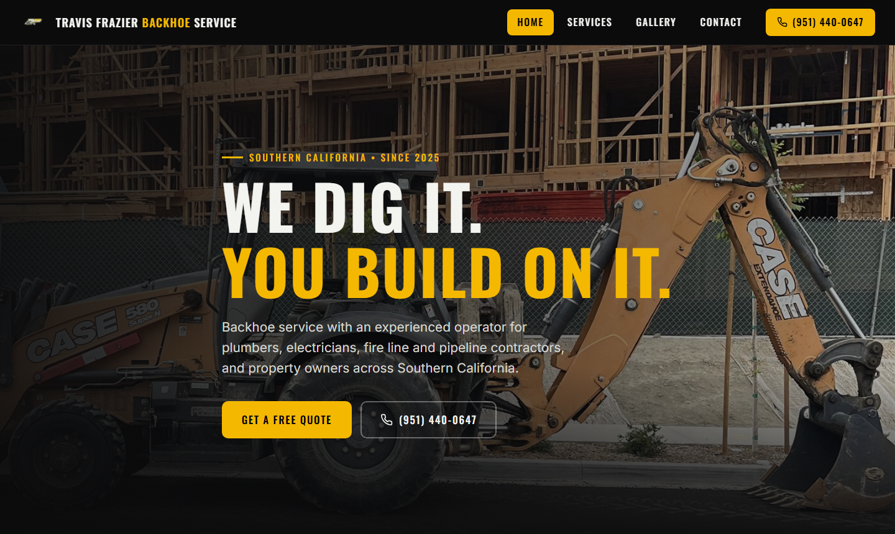

# Travis Frazier Backhoe Service LLC

A modern, mobile-friendly website for a Southern California backhoe and excavation company, built by [Dry Lightning Labs](https://github.com/gfrazier620-afk) as a gift for the owner.

**Live preview:** https://gfrazier620-afk.github.io/backhoe-website/



## Pages

- **Home**: full-screen hero, services, how it works, recent work, and meet the owner
- **Services**: all six services, why choose us, and a quote form
- **Gallery**: photos of the equipment and work, with a click-to-enlarge viewer
- **Contact**: phone, email, service area, and the quote form

## Tech

Plain HTML, CSS, and JavaScript, with no framework. Fonts (Oswald and Inter) load from Google Fonts.

- **Quote form:** sends to Travis by email through [FormSubmit](https://formsubmit.co) and falls back to opening the visitor's email app if that fails. The first time it is used, FormSubmit emails Travis a one-time confirmation link that must be clicked.
- **Search and sharing:** page titles and descriptions, canonical URLs, business structured data (JSON-LD), `sitemap.xml`, `robots.txt`, and a social-share image.
- **Pages are generated** from `tools/build_pages.py` (Python 3 + Pillow). Edit the script and run `python tools/build_pages.py` to rebuild the HTML, sitemap, share image, and favicons. Set `SITE_URL` in that script when the custom domain goes live.

```
index.html  services.html  gallery.html  contact.html
sitemap.xml  robots.txt  favicon.ico
assets/  css/styles.css  js/main.js  img/
tools/build_pages.py
```

To run it locally, open `index.html` in a browser, or serve the folder:

```bash
python -m http.server 8000
```

## Hosting

The live preview is served by GitHub Pages from the `main` branch. Pushing to `main` redeploys it.

## Status

This was my first website design project, redesigned in November 2026. A custom domain is planned.
